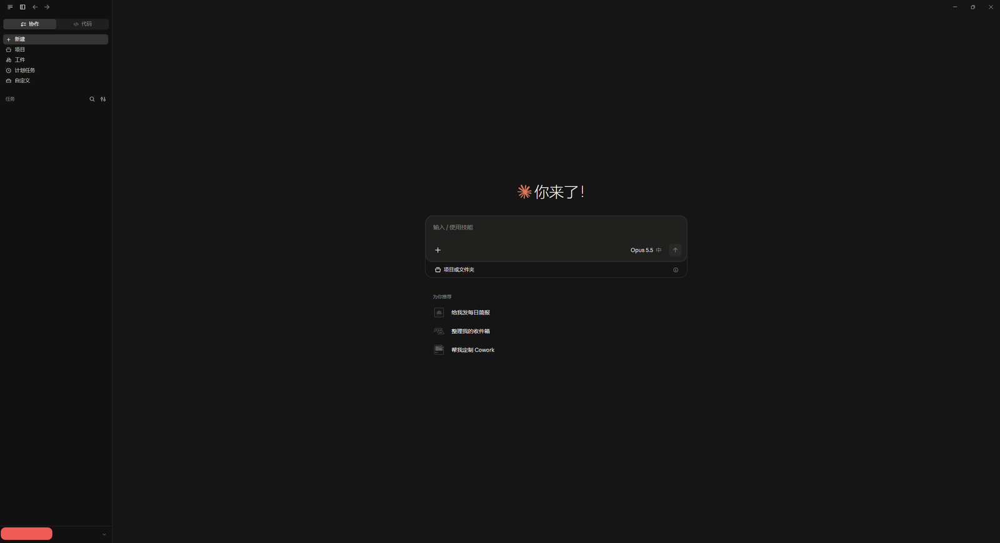
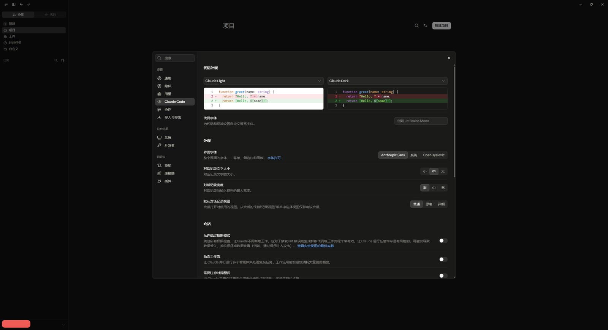
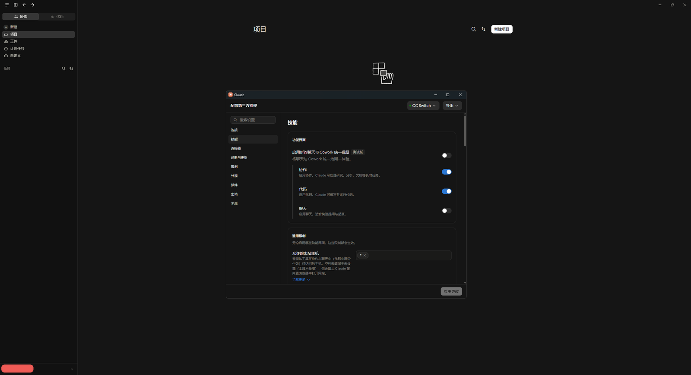
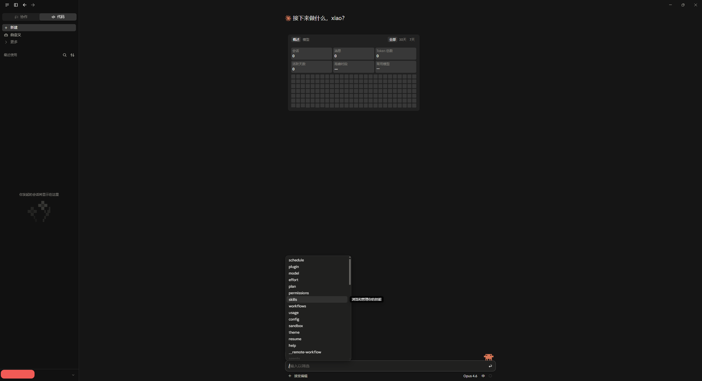
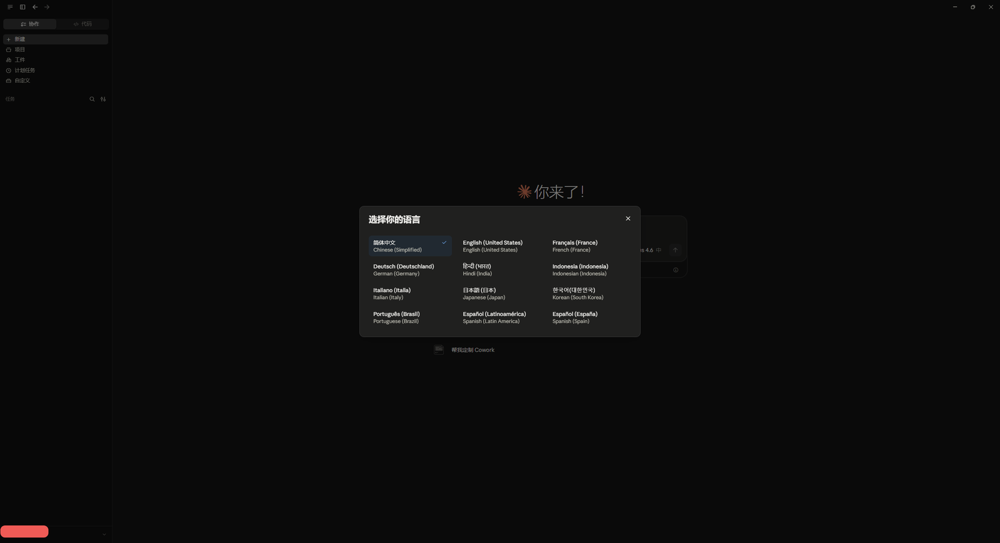

# Claude Desktop 简体中文汉化

> 把 Claude Desktop（Windows MSIX 版）的界面完整汉化为简体中文——菜单、按钮、弹窗、
> 提示语、设置页、权限对话框、技能描述、Claude Code 内核命令描述全覆盖。

| 项目 | 内容 |
|---|---|
| 项目名称 | Claude Desktop 简体中文汉化（Claude Desktop Simplified Chinese Localization） |
| 仓库地址 | **https://github.com/CGxiao5/claude-desktop-zh** |
| 当前版本 | **v4.1** |
| 作者 | CGxiao5 |
| 开源许可 | **MIT**（见 [`LICENSE`](LICENSE)） |
| 适用平台 | Windows 10 / 11，x64 |
| 适配对象 | Claude Desktop **MSIX 版**（实测 `2.42304.0.0`） |
| 词条规模 | 词条仓库 **19,982 条**；构建后前端词表 **35,441 条** |
| 运行时 | 内置精简 Python 3.15.0（293 文件 / 约 16 MB，随包携带、全程离线） |

---

## 界面预览

以下截图均来自汉化后的 Claude Desktop（Windows MSIX 版 `2.42304.0.0`），界面语言 `zh-Hans`。

**1. 主界面** —— 侧边栏导航（搜索/聊天/项目/计划任务等）、欢迎语「你来了！」、模型选择器与建议操作全部为简体中文


**2. 设置 · 外观** —— 主题、代码字体、界面字体、界面缩放、对话记录宽度及各功能开关均为中文


**3. 设置 · 技能** —— 功能预览、智能体开关、联网搜索与自定义技能管理界面均已汉化


**4. 对话与斜杠命令** —— 提问引导语、模型对比表格与 `/` 命令面板（schedule、todos、plan 等）中文可用


**5. 语言选择器** —— 「选择你的语言」弹窗中「简体中文 (Chinese (Simplified))」高亮可选


---

## 一、项目简介与来源

### 1.1 这是什么

一个**纯本地的第三方汉化工具**。它不改 Claude 的云端行为，也不碰你的账号数据，
只做一件事：把 Claude Desktop 安装目录里那些写着英文的资源文件，替换/补丁成中文，
并在 Claude 自动更新后把它们再补回来。

所有操作都在你自己的电脑上完成，全程**不联网**。

### 1.2 与原版 Claude Desktop 的关系

| 维度 | 说明 |
|---|---|
| 性质 | 第三方本地化补丁工具，**不是** Anthropic 官方产品，也未获其授权或背书 |
| 依赖 | 你必须先自行安装正版 Claude Desktop；本项目不包含也不分发 Claude 本体 |
| 作用位置 | 仅修改本地已安装文件（WindowsApps 应用目录、`%LOCALAPPDATA%`、`%USERPROFILE%\.claude`） |
| 数据影响 | **不影响账号、订阅与云端聊天记录**——聊天记录保存在 Anthropic 服务器，本地卸载不删它们 |
| 可还原性 | 选项 2 提供**字节级还原**，装回英文原状 |
| 商标 | "Claude"、"Anthropic" 为 Anthropic, PBC 的商标，归其各自所有者；本项目仅作指代性使用 |

### 1.3 汉化是怎么做到的

Claude Desktop 是 Electron 应用，界面文本分散在**五个层次**，本项目逐层处理：

| 层次 | 位置 | 汉化方式 |
|---|---|---|
| 渲染层 | `ion-dist/i18n/zh-Hans.json` | 部署完整中文词表（key → 中文） |
| 动态层 | `ion-dist/i18n/dynamic/zh-Hans.json` | 部署 dynamic 词表，缺失会导致前端丢词 |
| Shell 层 | `resources/zh-Hans.json` | 增补标题栏、设置页、权限对话框词条 |
| 内核层 | `claude.exe` | 直接改写 Bun 字符串表 + 源码字面量（**等长替换**） |
| 技能层 | `app.asar`、`skills-plugin` | 补丁技能描述，并修复两层 integrity 校验链 |

另外还需要把 `zh-Hans` 加入前端的语言白名单与语言名映射，
并把配置里的 `locale` 写成 `zh-Hans`，界面才会真的切到中文。

> 内核与 asar 的修改涉及二进制结构：字符串表要求**等长替换**（不足补空格，绝不能补 `\0`），
> app.asar 修改后必须重算 SHA256 完整性链并同步回 exe 内的资源表，否则 Claude 会自修复回英文。

### 1.4 第三方来源

- 前端 / shell / dynamic **基础词库**来源于社区项目 **ldk-tokyo**，本项目在其之上做增补、修正与术语统一
- 内置 Python 运行时为 **CPython 3.15.0** 与 **pywin32** 的精简裁剪（许可说明见 [`LICENSE`](LICENSE) 末尾）

---

## 二、汉化内容与功能特点

### 2.1 覆盖范围

| 类别 | 条目数 | 说明 |
|---|---|---|
| 前端基础词库 | 23,702 | 来自 ldk-tokyo 社区词库 |
| 渲染层 key 增补 | 20,315 | 由词条仓库构建，覆盖界面绝大多数文案 |
| 词条仓库（唯一真相源） | 19,982 | 见下方命名空间明细 |
| shell 层增补 | 626 | 标题栏 / 设置页 / 权限对话框 |
| Claude Code 内核命令描述 | 158 | 字符串表补丁 |
| 内核源码字面量 | 47 | 源码级等长替换 |
| dynamic 增补 | 49 | 仓库优先叠加 |
| app.asar 技能描述 | 12 | 含 integrity 链修复 |
| 技能描述（skills-plugin） | 11 | manifest.json + SKILL.md |

词条仓库 `zh-store.json` 的命名空间构成：

| 命名空间 | 条目数 | 命名空间 | 条目数 |
|---|---|---|---|
| `fe-val` | 19,097 | `kernel-source` | 47 |
| `fe-key` | 517 | `asar-source` | 12 |
| `kernel-table` | 158 | `skill` | 11 |
| `shell-val` | 140 | `shell-key` | 0 |

### 2.2 功能特点

**① 一体化菜单入口**
双击 `Claude汉化.cmd`，输入数字即可，无需记命令。

**② 内置 Python 运行时，零环境依赖**
服务需要 Python + pywin32。早期版本绑定系统里"碰巧装着"的 Python，用户卸载/升级 Python
后服务会静默失效（SCM 1053），极难排查。v4.1 改为**汉化包自带精简运行时**：

- 体积约 16 MB / 293 个文件（由完整安装 436 MB 裁剪而来，去掉 test、pip、tkinter、
  第三方包、OpenSSL 等无关成分）
- 安装时从 `zh\python` 复制到 `%USERPROFILE%\.claude\zh\python\`
- 路径**全部相对解析**（`zhpy.py` 从自身位置向上查找），不写死任何盘符，整个目录可整体搬家
- 全程**离线**，安装/卸载都不联网；包内缺失时输出明确错误，**绝不静默下载**
- 可用 `zh\tools\build_embedded_python.py` 从本机 CPython + pywin32 自行重建

**③ Windows 服务常驻自愈**
汉化本体（词表、JS 补丁、locale）落盘即持久，本身不需要进程。真正需要"有人盯着"的是三件事：

1. **技能描述**：Claude 每次启动都会用 app.asar 内的原始文件覆盖 `skills-plugin` 下的译文
2. **内核命令描述**：Claude Code 内核自动更新后，字符串表与源码补丁丢失
3. **自愈基线**：Claude 自动更新 / MSIX 自修复可能把词表、JS 补丁、locale 回滚成英文态

服务每 10 秒轮询一次上述三项，发现问题就地修复；每 60 秒做一次基线比对。

**④ 目录无关、跨机器通用**
路径全部由环境变量动态拼接（`%USERPROFILE%` / `%LOCALAPPDATA%` / `%APPDATA%`），
无硬编码用户名、无硬编码用户路径。项目目录移动或改名**不影响已安装的服务**。

**⑤ 卸载可完整还原**
按 `.claude\zh\backup` 中的日志与备份**字节级还原**：4 个 JS、app.asar（含 integrity 链）、
内核补丁、shell 词表、locale 回 `en-US`。

**⑥ 彻底卸载不留痕迹**
先扫描 → 展示会删什么 → 确认后才执行，逐项先检测存在性。
另有**硬护栏**：脚本自身所在目录及盘符根目录、系统关键目录一律拒绝删除。

---

## 三、安装与使用

### 3.1 环境要求

- Windows 10 / 11（x64）
- 已安装 **Claude Desktop MSIX 版**（Microsoft Store 或官方安装包）
- **不需要**预先安装 Python、pywin32 或任何第三方运行时
- 需要**管理员权限**（要改写 WindowsApps 下的文件并注册 Windows 服务）

### 3.2 获取项目

```bash
git clone https://github.com/CGxiao5/claude-desktop-zh.git
cd AI
```

### 3.3 安装

以**管理员身份**右键运行 `Claude汉化.cmd`（普通权限会在启动时被明确拒绝并退出），
输入 `1`：

```
    1   安装 Claude 汉化
    2   卸载 Claude 汉化   （保留 Claude，界面恢复英文）
    3   彻底卸载 Claude    （移除应用本体及全部残留）
    0   退出
```

安装完成后**完全退出 Claude（含系统托盘）再重新启动**，界面即为中文。

### 3.4 三个选项怎么选

| 需求 | 选哪个 | 结果 |
|---|---|---|
| 想让 Claude 显示中文 | `1` | 安装汉化，重启 Claude 后界面为中文 |
| 想回到英文 Claude | `2` | 还原全部补丁，Claude 本体保留，词条仓库保留 |
| 不想用 Claude 了 | `3` | 先扫描列出会删什么 → 确认后移除应用与全部残留 |

选项 `3` 的确认环节：**回车或输入 `Y` 执行，输入 `N` 取消**（不区分大小写）。

### 3.5 安装做了什么（8 个阶段）

| 阶段 | 内容 |
|---|---|
| 1 | 检测 Claude 安装（MSIX 包探测）、AUMID 运行时解析 |
| 1b | 多轮强退 Claude 进程（子进程会陆续孵化，单轮杀不干净） |
| 2 | 检测前端资源结构（白名单 / 语言名 / 标签 3 组文本） |
| 3 | 备份原始 JS 与 ACL；词条仓库迁移与词表重建 |
| 3b | 词条仓库登记与产物重建 |
| 4-5 | 部署词表（渲染层 / dynamic / shell 层） |
| 6 | 补丁 4 个 JS 语言白名单 |
| 7 | 写入 `locale = zh-Hans` |
| 7a-2 | **部署内置 Python 运行时**（版本一致则跳过，不重复拷贝 16 MB） |
| 7b | 技能描述汉化；部署服务宿主与补丁模块 |
| 7c/7d | Claude Code 内核补丁（字符串表 + 源码字面量，同步执行） |
| 7e | 写入自愈基线（词表 SHA1 + JS 补丁三元组） |
| 7f | asar 技能描述补丁 + 两层 integrity 修复 |
| 7g | **注册并启动 Claude_zh 服务**（必须在基线写好之后，否则会自愈回旧状态） |
| 8 | 校验 |

### 3.6 服务管理

| 属性 | 值 |
|---|---|
| 服务名 | `Claude_zh` |
| 显示名 | Claude Desktop 简体中文汉化服务 |
| 启动类型 | 自动（开机自启） |
| 运行账户 | LocalSystem（不依赖任何用户登录会话） |
| 宿主 | `%USERPROFILE%\.claude\zh\python\pythonservice.exe` + 同目录 `zh_service.py` |
| 日志 | `%USERPROFILE%\.claude\zh\service.log` |

```powershell
Get-Service Claude_zh                                   # 查看状态
Start-Service Claude_zh ; Stop-Service Claude_zh -Force  # 启停
& "$env:USERPROFILE\.claude\zh\python\python.exe" `
  "$env:USERPROFILE\.claude\zh\zh_service.py" remove     # 删除注册
```

停止服务**不会卸载汉化**，只是失去自动维护能力（Claude 更新后不会自动恢复中文）。

> **LocalSystem 下的用户目录修正**：服务以 LocalSystem 运行，进程环境里的
> `USERPROFILE` / `APPDATA` / `LOCALAPPDATA` 全部指向 `C:\Windows\System32\config\systemprofile`，
> **不是**装了 Claude 的那个用户。服务启动第一件事是读取
> `%USERPROFILE%\.claude\zh\install-context.json` 的 `zhHome`，反推用户根目录并覆盖进程
> 环境变量——否则服务看起来在跑，实际什么都没修。

### 3.7 彻底卸载的清理范围

| 组 | 范围 | 清理对象 |
|---|---|---|
| **A** | C 盘 | MSIX 应用包（官方 `Remove-AppxPackage`）+ 安装目录残留 |
| **A2** | 其他盘符 | 只检查标准安装路径，逐个盘符判断，**不做通配扫描、不碰盘内其他内容** |
| **B** | C 盘 | 用户配置与数据：`%LOCALAPPDATA%\Claude`、`Claude-3p`、`Claude-Data`、`AnthropicClaude`、`Temp\claude`、`%APPDATA%\Claude`、`Claude-Data`、`C:\ProgramData\Claude`、`~/.claude`、`~/.claude.json` |
| **B2** | C 盘 | 顶层兜底扫描：在用户目录、`ProgramData`、`Program Files`、`%TEMP%` 的**顶层**查找名称含 `claude` / `anthropic` 的目录 |
| **C** | 全局 | 桌面 / 开始菜单 / 公共桌面 / 开机启动项快捷方式 |
| **D** | 注册表 | MSIX 包注册信息；软件自建键；`App Paths\Claude.exe`；服务键；卸载信息项；用户环境变量（**跳过 `Path`**） |
| **E** | C 盘 | `%TEMP%` 下 `claude*` 临时文件与安装日志 |

> **注意**：彻底卸载为**直接清除模式**——不创建任何备份、压缩包或还原点，不经过回收站，
> **删除不可恢复**。若需保留配置，请在卸载前自行另存。
> Claude 聊天记录保存在云端，不受本地卸载影响。

---

## 四、目录结构

```
.
├── Claude汉化.cmd              ← 唯一入口：交互式菜单（GBK 编码，勿转 UTF-8）
├── README.md
├── LICENSE                     ← MIT 许可 + 第三方组件许可说明
├── .gitignore
└── zh/                         ← 汉化工程目录
    ├── resources/              ← 词表资源（安装时被部署）
    │   ├── custom-keys-zh.json       渲染层 key 增补 20,315 条（由仓库构建）
    │   ├── shell-overlay-zh.json     shell 层增补 626 条
    │   ├── dynamic-overlay-zh.json   dynamic 增补 49 条（仓库优先）
    │   ├── custom-overlay-zh.json    手工补充词典（值映射）49 条
    │   ├── frontend-zh-CN.json       前端基础词库 23,702 条（第三方来源）
    │   ├── desktop-zh-CN.json        shell 基础词库 491 条（第三方来源）
    │   ├── dynamic-zh-CN.json        dynamic 基础词库 49 条（必须部署）
    │   └── translations/
    │       ├── zh-store.json         ★ 词条仓库唯一真相源（卸载不删除）
    │       └── backup/               运行时自动备份（已 gitignore）
    ├── python/                 ← 内置精简 Python 运行时（约 16 MB，随包携带、离线）
    │   ├── python.exe / pythonw.exe / python315.dll
    │   ├── pythonservice.exe         服务宿主（pywin32）
    │   ├── DLLs/ Lib/                仅服务所需的扩展模块与标准库
    │   └── RUNTIME.json              版本与构建信息
    ├── scripts/                ← 安装 / 卸载 / 服务 / 补丁模块
    │   ├── install-zh.ps1            安装主脚本（8 阶段）
    │   ├── uninstall-zh.ps1          卸载主脚本（按日志精确还原）
    │   ├── zhpy.py                   内置运行时定位器（相对路径解析，缺失即报错）
    │   ├── zh_service.py             ★ Windows 服务 Claude_zh 的宿主
    │   ├── skills-watch.py           常驻循环体（技能重译 / 内核重打 / 基线自愈）
    │   ├── translate-skills.py       技能描述汉化
    │   ├── translate-kernel.py       Claude Code 内核字符串表补丁（带文件锁）
    │   ├── translate-kernel-source.py 内核源码字面量补丁（等长替换，带文件锁）
    │   ├── translate-asar-source.py  app.asar 技能描述补丁（+ 两层 integrity 修复）
    │   ├── write-state.py            自愈基线写入
    │   ├── seed-store.py             词条入库脚本
    │   └── zhstore.py                词条仓库读写模块
    └── tools/                  ← 构建与验证（不参与安装，开发期使用）
        ├── build_additions.py        由仓库构建三份增补词表（安装时调用）
        ├── build_embedded_python.py  构建内置精简 Python 运行时（离线裁剪）
        ├── _probe_closure.py         运行时依赖闭包探测
        ├── manual_extra.py           手工词条源（构建依赖）
        ├── manual_fuzzy.py           模糊定位修正词条（构建依赖）
        ├── shell_manual.py           shell 层手工词条源（构建依赖）
        ├── audit_matched.json        前端词库匹配审计产物
        ├── shell_fe_ids.json         shell 层 ID → 原文映射
        ├── sync_check.py             同步性四维检查（仓库↔产物↔部署）
        ├── verify_state.py           安装态 / 卸载态核验（25 项 / 17 项）
        ├── rebuild_runtime.py        运行时资产确定性重建（灾难恢复）
        └── rebuild_kernel_log.py     内核还原日志重建（灾难恢复）
```

### 两个 `zh` 目录别搞混

| 目录 | 作用 | 生命周期 |
|---|---|---|
| 项目内 `zh\` | 汉化资源、脚本、工具、**内置 Python 运行时**——**你要分发/备份的就是这个** | 长期保存 |
| `%USERPROFILE%\.claude\zh\` | 运行时部署：内置运行时副本、服务宿主、原始备份、补丁日志、自愈基线 | 安装时创建，卸载时删除 |

---

## 五、常见问题排查

**Q1. 双击脚本提示"当前不是管理员权限"**
必须在文件上右键 → 以管理员身份运行。汉化要改写 WindowsApps 下的文件并注册 Windows
服务，这两类操作强制要求管理员权限。脚本不会自动提权——半途失败会留下不一致状态。

**Q2. 安装报"未在 WindowsApps 下找到可用的 Claude 安装"**
Claude Desktop 未安装，或已通过系统设置卸载。安装 Claude 后重跑即可。

**Q3. 装完界面还是英文**
按顺序检查：① 完全退出 Claude 后重新启动（系统托盘图标也要退出）；
② 确认 `Claude汉化.cmd` 菜单里显示的"服务"状态是"已注册(Running)"；
③ 运行 `python zh\tools\verify_state.py installed` 看哪一项 FAIL。

**Q4. 服务状态显示"未注册"**
服务使用汉化包自带的 Python 运行时，**不需要你额外安装 Python 或 pywin32**。未注册
通常只有两种原因：

1. 汉化包缺少 `zh\python` 目录（包不完整）——安装时会打印
   `[警告] 汉化包缺少内置 Python 运行环境`，请用完整汉化包重装；
2. 服务注册被安全策略拦截——用管理员 PowerShell 手动注册：
   `& "$env:USERPROFILE\.claude\zh\python\python.exe" "$env:USERPROFILE\.claude\zh\zh_service.py" install`

以上都不影响已生效的汉化本体，只影响"Claude 更新后自动恢复"的能力。

**Q5. Claude 自动更新后汉化失效**
服务会在 10 秒轮询内自动恢复。若长时间没恢复，重跑一次安装（菜单选项 1）。

**Q6. 界面白屏**
这是服务端地区限制（`claude.ai` 302 跳转到 `app-unavailable-in-region`），
与汉化无关——已通过五步排除法实证。

**Q7. 卸载时报"文件被占用"**
Claude 进程未完全退出。关闭 Claude 后重跑；脚本已采用多轮强退，通常一次即可。

**Q8. 卸载后想恢复汉化**
菜单选项 1 重新安装即可。词条仓库保留，不需要重新翻译任何词条。

**Q9. 彻底卸载后想恢复**
重装 Claude Desktop → 运行 `Claude汉化.cmd` → 选项 1。
注意：彻底卸载是**直接清除**，本地配置、会话、`~/.claude` 等均已删除且**没有备份**，无法取回；
聊天记录在云端不受影响。

**Q10. 服务停止时卡住**
正常不会：服务主循环采用 0.5 秒分片等待响应停止信号，实测 1.5 秒内完成停止
（远低于 Windows 的 30 秒服务停止超时）。

**Q11. 彻底卸载现在还有几步？还会不会备份？**
共 5 步：`[1/5]` 扫描 → `[2/5]` 停服务与进程 → `[3/5]` 卸载 MSIX 应用包 →
`[4/5]` 逐项删除 → `[5/5]` 结果摘要与残留复检。
**不会备份**：原 `[3/6] 归档` 步骤已整段移除，用户数据直接删除。
旧版本曾在 `if (...)` 块内用多行 `echo` 拼临时 `.ps1`，脚本里的 `)` 被 cmd 当成块结束符
导致脚本截断、PowerShell 报 `ParserError: MissingEndParenthesisInSubexpression`，
进而误判"归档失败"并整批跳过删除；该隐患随归档步骤一并消除。

**Q12. 安装时 `[kernel]` / `[kernel-src]` / `[asar-src]` 三行显示成「宸叉洿鏂?」之类乱码**
这是**控制台编码错配**，不是汉化失败（词表与补丁都写入成功）。
内置运行时是 Python 3.15，自 3.15 起**默认启用 UTF-8 模式（PEP 686）**，经管道输出的是
UTF-8 字节；而 PowerShell 捕获外部程序输出时按 `[Console]::OutputEncoding`
（中文 Windows 为 GBK/936）解码，两者不一致即成乱码。
只有**被捕获**的调用会中招（`$ko = & $pyExe $s 2>&1`）；直连控制台的调用走
`WriteConsoleW`，所以技能汉化那几行一直是正常的。
已在 `install-zh.ps1` / `uninstall-zh.ps1` 顶部加入对齐逻辑：把 `PYTHONIOENCODING`
显式设为当前控制台代码页（`cp936`，若控制台是 65001 则用 `utf-8`），乱码已消除。

**Q13. 修改 `Claude汉化.cmd` 后脚本报错**
`cmd.exe` 始终按系统 ANSI 代码页（中文 Windows 为 936/GBK）读取批处理文件。
若存成 UTF-8，中文会被按 GBK 误解析——轻则乱码，重则某些字节被当成引号/管道符，
直接破坏 `for /f` 与 `echo` 的语法结构。**该文件必须以 GBK 保存，且不要执行 `chcp 65001`。**

---

## 六、开发者工具

```powershell
python zh\tools\sync_check.py              # 同步性四维检查：仓库↔产物↔部署↔硬编码
python zh\tools\verify_state.py installed  # 安装态核验（25 项）
python zh\tools\verify_state.py uninstalled # 卸载态核验（17 项）
python zh\tools\build_additions.py         # 由词条仓库重建三份增补词表
python zh\tools\build_embedded_python.py   # 从本机 CPython + pywin32 重建内置运行时
```

改动词条请写入 `zh\resources\translations\zh-store.json`（或经 `seed-store.py` 入库），
再跑 `build_additions.py` 重新构建产物——**不要直接改 `resources` 下的产物文件**。

---

## 七、致谢

- **ldk-tokyo** —— 前端 / shell / dynamic 基础词库的来源社区项目，本项目在其之上做增补与修正
- **Python Software Foundation** 与 **CPython** 贡献者 —— 内置运行时所依赖的解释器
- **Mark Hammond 及 pywin32 贡献者** —— Windows 服务宿主 `pythonservice.exe`
- **Anthropic, PBC** —— Claude 本体；本项目仅为本地化补丁工具，与其官方无关

---

## 八、版权与免责声明

- **本项目**：代码与文档采用 **MIT 许可**（见 [`LICENSE`](LICENSE)），作者 CGxiao5。
  你可以自由使用、修改、分发，包括用于商业目的，但须保留版权与许可声明。
- **第三方组件**：`zh/python/` 下的 CPython、pywin32、VC++ 运行库等二进制文件遵循各自
  上游许可（PSF-2.0 等），详见 [`LICENSE`](LICENSE) 末尾的"第三方组件许可说明"。
- **Claude 本体**：Claude Desktop 的版权、商标与知识产权均归 **Anthropic, PBC** 所有。
  本项目不分发、不包含、不逆向分发 Claude 的任何原始文件，仅提供补丁脚本与中文词表。
- **免责声明**：本项目按"原样"提供，**不作任何明示或暗示的担保**。
  它会修改你本地已安装的 Claude Desktop 文件并注册一个 Windows 服务。
  虽然提供了卸载与字节级还原能力，但作者不对因使用本工具导致的任何数据丢失、
  软件损坏、服务异常或账号问题负责。
  **使用前请自行备份重要数据**；菜单选项 3（彻底卸载）为不可逆操作，请谨慎确认。
- **合规性**：本工具仅用于个人学习与本地化目的。使用它前，请确保你的行为符合
  你所在地区的法律法规以及 Claude 的服务条款。

---

## 九、开源许可

本项目主体采用 **[MIT License](LICENSE)**。

```
MIT License

Copyright (c) 2026 CGxiao5

Permission is hereby granted, free of charge, to any person obtaining a copy
of this software and associated documentation files (the "Software"), to deal
in the Software without restriction, including without limitation the rights
to use, copy, modify, merge, publish, distribute, sublicense, and/or sell
copies of the Software...
```

完整条款（含第三方组件许可说明）见仓库根目录的 [`LICENSE`](LICENSE) 文件。
